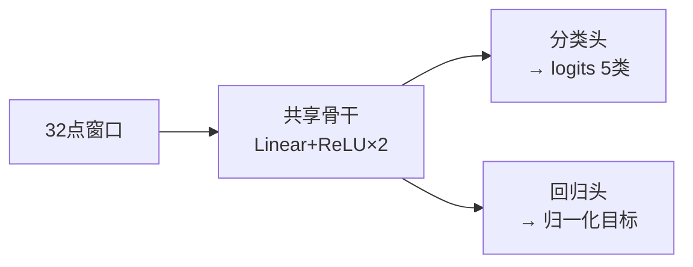

# 01 概念教材: 波形参数提取的多任务学习

## 1. 任务定义

- **输入**: 32 点窗口 x[0..31] (一段 ADC 采样; 目前由程序内部模拟生成)
- **输出**:
  - 分类头: 5 类 —— sine / square / triangle / saw / **noise(未知)**
  - 回归头: 参数 —— A(幅值), k(窗口内周期数), φ(初相), offset(直流偏置), duty(占空比, 仅方波)

**为什么"回归参数"而不是"直接波形→波形"**(对比之前 saw2sin 的黑箱映射):
- 可解释: 参数有物理意义, 可用于后处理 / 监控 / 报警
- 可门控: 分类置信度低 → 拒绝输出参数, 避免对噪声强行生成正弦
- 可外推: 参数空间的规律比波形空间简单

**k 为什么用"窗口内周期数"而不是 Hz**: 与采样率解耦 (Hz = k·fs/N); 换采样率不用重训, 只换换算常数。

## 2. 多任务头结构 (hard parameter sharing)

分类要的"周期数/幅值/形状"特征, 回归也全都要用 → 共享让两个任务的梯度共同塑造同一组特征, 等效互相正则化。
代价: 任务之间会抢容量和梯度份额 (见 §5)。

## 3. 三个关键工程问题

### 3.1 掩码损失 (masked loss)
不是每个样本的每个参数都有定义: **duty 只对方波有意义; noise 类没有回归标签**。
做法: 每个样本生成一个 mask 向量 (1=参与监督, 0=忽略), 损失只统计 mask=1 的元素。

### 3.2 目标归一化
φ 最大 6.28, offset 只有 0.3 —— 直接回归物理量, 损失会被大数量级参数主导。
做法: 每个参数按已知范围线性映射到 [0,1] 再监督; 评估时反归一化回物理量。

### 3.3 损失与权重
$$L = \lambda_{cls}\cdot CE + \lambda_{reg}\cdot \text{masked\ MSE}$$
- `lambda_cls / lambda_reg`: 任务间平衡
- `reg_weights` (A,k,φ,offset,duty): 任务内各参数的平衡
- 加权会改变"梯度预算"的分配 —— 加大 k 权重, k 精度回升 (见实验档案 F3)

## 4. 本项目最重要的两个发现

### 4.1 相位表示要用 (cosφ, sinφ), 不要直接回归 φ
- 直接回归 φ: 目标在 0/2π 处**有跳变** (φ=0.05 与 φ=6.23 的波形几乎相同, 但目标差 2π);
  损失 (Δφ)² **无界** (差半圈 = 39)
- (cosφ, sinφ): 两个**光滑连续**的目标; 损失 = 2(1−cosΔφ), **有界** (≤4)、处处光滑
- 实测效果: 相位圆周误差 −63% (见实验档案)
- 通用套路: 回归"环形量"(角度/方向)都用对偶表示 —— 旋转里的四元数、方向里的单位向量都是同一思想

### 4.2 多任务梯度预算竞争
F2 实验: 把 φ 从 1 维目标改成 2 维后, φ 精度大涨, 但 **k 精度变差** (0.144→0.199), 分类不变。
解释: 损失里各任务占的"份额"变了 (对非方波样本: k 的份额 1/4 → 1/5), k 分到的梯度变少。
对策: 加权补偿 (F3: k 权重×2, 份额回到 1/4, k 回到 0.159) —— **多任务工程本质是"份额管理"**。

## 5. 评估体系 (读 log.json 的五个数)

| 指标 | 含义 | 要点 |
|---|---|---|
| `acc` | 分类准确率 | >0.99 算基本解决 |
| `k` | 周期数 MAE | 单位: 周期/窗 |
| `phi` | 相位 MAE (普通口径) | 会被 0/2π 翻转**虚高** |
| `phi_circ` | 相位 MAE (圆周口径) | 跨边界翻转不算误差, **以这个为准** |
| `recon` | 重建 RMSE | 最终指标: 用预测参数重建波形 vs 原波形 |

锚点: recon ≈ 0.55~0.60 = "输出全零"的平凡水平; 越接近噪声水平越好。
为什么 recon 是最终指标: 下游任务是"用参数生成波形", 参数误差只有反映到波形误差上才算数。

## 6. 部署约束 (提前内建)

F28P55x NPU 的硬约束 (来自 ti-npu 工程实测):
- batch 只支持 1; 计算图只允许 Linear+ReLU 系 (导出时按 1×1 卷积重写)
- 通道数须是 4 的倍数; 8bit 激活
- softmax / 门控 / 参数反归一化 **不进计算图**, 在 C 端做
本工程从一开始就满足这些结构约束 — 详见 `model.py` 顶部注释。
