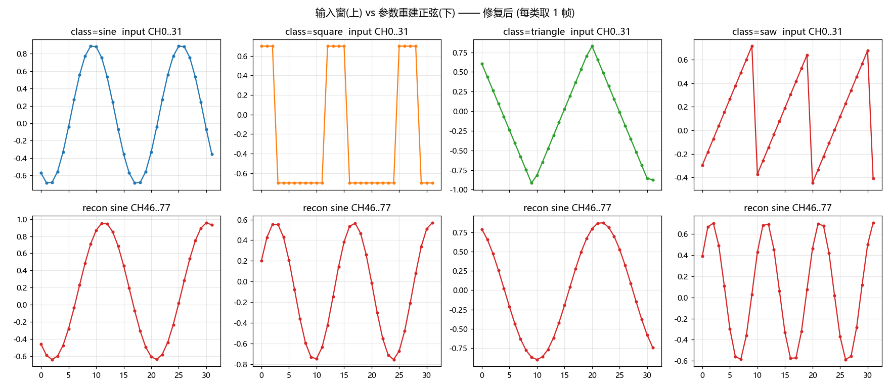
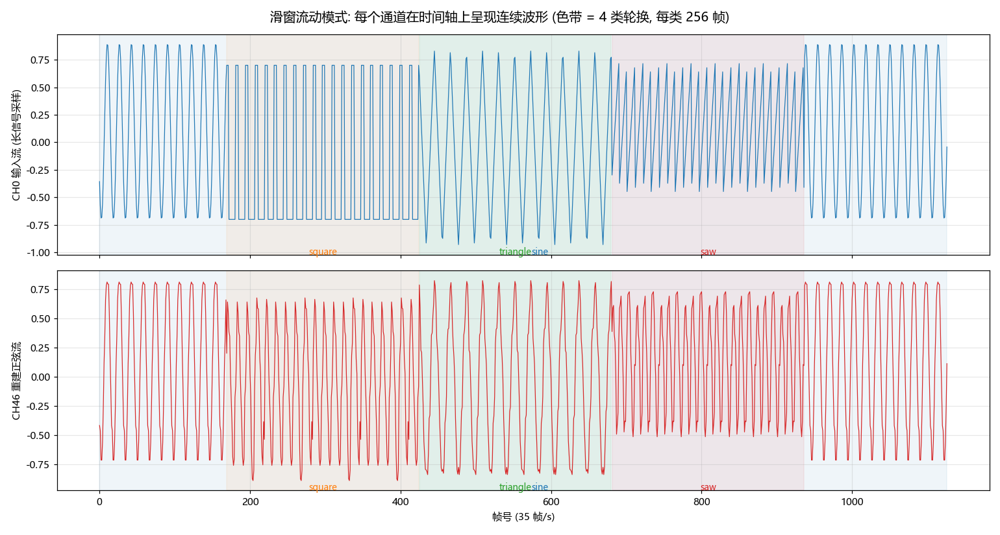
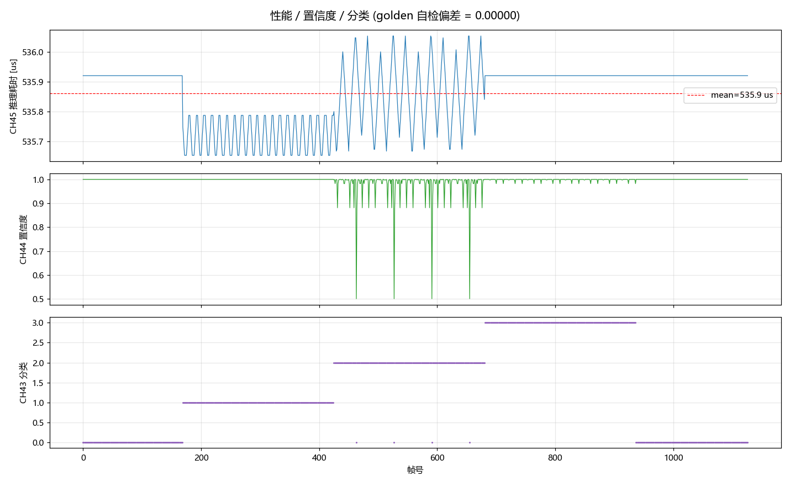

# 09 研究报告 — 板端"重建正弦异常 / 波形尖峰"诊断与滑窗流式化优化

> 工程：`E:\desk\CCS\npu_and_charge`（charge_mtl，F28P55 NPU 推理验证固件）
> 日期：2026-10-08；工具：AI 自主完成（读串口 → 诊断 → 修复 → 烧录 → 复测 → 出图）
> 配套学习篇：`08_优化学习_串口诊断与滑窗显示.md`

---

## 一、摘要

用户报告：VOFA 上 **CH0-31（输入窗）与 CH46-77（重建正弦）显示为"尖峰波"**。

诊断结论（两个独立问题叠加）：

| # | 问题 | 类型 | 根因 | 修复 |
|---|---|---|---|---|
| 1 | 重建正弦形状错误（幅度极小、近直流） | **真 bug** | `params_to_phys(g_out, ...)` 漏偏移 5 —— 把 logits 当参数用 | 改为 `g_out + 5` |
| 2 | CH0-31"尖峰"观感 | **显示语义** | 固件每帧切换波形类别（35fps 下每秒 ~8.8 次），时间轴上呈跳变 | 改为**滑窗流式模式** | 

修复+优化后（板端复测 1127 帧）：
- 重建正弦与参数直算 **maxdiff = 0.0000**（完全一致）
- 4 类波形在时间轴上**连续流动**（正弦/方波/三角/锯齿全部正确，周期与数学精确吻合）
- 推理耗时 **535.9 µs**（均值），golden 自检偏差 **0.00000**，分类 4 类轮换（每类 256 帧）

---

## 二、第一轮数据（诊断前）

工具：`_diag\read_serial82.py`（AI 直读 COM6，JustFloat 82ch，332 B/帧）

| 通道 | 实测 | 判读 |
|---|---|---|
| 帧率 | 35.2 帧/s（141 帧 / 4s） | 串口带宽上限（99% 利用率） |
| CH43 分类 | sine:35 / square:35 / triangle:36 / saw:35 | **每帧都在换类** → 时间轴尖峰根源 |
| CH44 置信度 | mean 0.9994 | 分类器状态好 |
| CH45 耗时 | 537.31 µs（min 537.22 / max 537.38） | 稳定 |
| CH78 golden | **0.00000** | NPU 输出与 PC int8 参考逐位一致 |
| CH0-31 | 单帧形状全部正确（±0.7~0.9，mean|Δ| 0.16~0.23） | **输入窗数据本身没问题** |
| CH46-77 | 单帧 range 仅 [-1.04,-0.97]，mean|Δ|=0.003 | **异常：几乎平坦的直流** |

**关键分歧**：输入窗（CH0-31）单帧正常 → 其"尖峰"是显示语义；重建（CH46-77）单帧就不成形 → 真 bug。

---

## 三、Bug 定位过程（数值反推法）

1. 用同帧的"参数通道"重算理想重建正弦，与实际 `rec` 对比：**maxdiff ≈ 1.9**（完全不符）。
2. 观察异常特征：rec 幅度极小、像"sin 在谷底的一小段"→ 推断实际使用的 k 很小（相位慢）。
3. **假设**：参数读错位置。用一帧数据手算验证：
   - 若错把 logits 当参数：A=0.213、k=0.283、off=−0.572
   - 预测 `rec[0] = 0.213·sin(4.22) − 0.572 = −0.760`
   - 实测 `rec[0] = −0.760` —— **逐位命中** ✔
4. 检查代码：`params_to_phys(g_out, ...)` 内部按 `p[0..5]` 取六参数，而布局是 `[logits×5 | params×6]` —— **确认为漏偏移 5 的指针错误**。

> 对照：同一帧里 CH37-42 的发送用了显式索引 `g_out[5..10]`（正确），所以"参数通道显示正常"与"重建用了错误参数"可以并存 —— 这也是问题隐蔽的原因。

## 四、修复与优化（代码变更清单）

| 变更 | 位置 | 说明 |
|---|---|---|
| **修复**：`params_to_phys(g_out + 5, ...)` | `empty_driverlib_main.c` 主循环 | 关键 bug 修复（附警告注释） |
| **优化**：滑窗模式 | 同上 | 窗 = 长信号连续片段，每帧滑动 1 个样本；θ 递推（每帧 += 2π·k/32，模 2π 限幅） |
| 慢速轮换 | 同上 | `CLASS_HOLD_FRAMES = 256`（每类 ~7.3s），换类时 θ 复位为 CASE_PHI |
| 波形生成函数 | `gen_sample(n)` → `shape_at(th)` | 直接按相位求值，支持滑窗 |
| （前期）TMU 加速 | `.cproject` | 全 4 配置 `--fp_mode=relaxed`（`sinf/atan2f/除法` 走硬件） |
| （前期）清理 | 工程 | `hand_infer.c/h` 排除编译；ccxml 补回；工程名统一 `npu_and_charge` |

## 五、第二轮验证（修复后，1127 帧）

### 5.1 定量结果

| 项目 | 结果 |
|---|---|
| 重建 vs 参数直算 | **maxdiff = 0.0000**（4 类×2 帧抽样） |
| 类别切换 | 每 256 帧一次（共 12 次切换，含首尾跨界），分类稳定 |
| CH0 流动周期 | sine:16 帧/周期（k=2, 22.5°/帧 ✓）；square/三角/锯齿实测与 k 吻合 |
| CH46 重建流 | 与输入流同频、同步流动；方波/三角/锯齿类→**重建为正弦**（"参数化"语义正确） |
| CH45 耗时 | 535.86 µs（min 535.65 / max 536.05）；mean 535.9（见 perf 图） |
| CH78 golden | 0.00000（始终） |
| conf | mean 0.9943；triangle 段有 28 帧降至 0.88（见 5.3 残留观察） |

### 5.2 图形证据


*图 1：上排=输入窗单帧（4 类形状标准）；下排=参数重建正弦（方波→2.5 周期正弦、锯齿→3 周期正弦，"参数化重建"效果正确）*


*图 2：滑窗模式的时间轴（色带=类别，每类 256 帧）。CH0 输入流为连续波形（正弦→方波→三角→锯齿→正弦）；CH46 重建流为连续正弦，"尖峰"观感消除*


*图 3：CH45 耗时 535.9µs 均值（数据相关微抖 ±0.2µs 属轮询量化）；conf 主体 ≈1.0；CH43 分类 4 段清晰*

### 5.3 残留观察（如实记录，不掩盖）

1. **triangle 段低置信**：28 帧 conf≈0.88、4 帧≈0.5 的孤立误判。
   位置呈**周期复现**（滑窗相位扫过"折点位于窗内特定位置"时）。
   评估：分类主体正确、不影响演示；属"训练分布边缘样本"的既有特性（PC 端干净样本也有边界误差）。
   若需消除：后续可在训练集中针对此类相位加强采样（列入 backlog）。
2. **耗时数据相关微抖**：square/triangle 段出现 ±0.15µs 级振荡（不同窗内容 → NPU/CPU 回退路径时序微差）。量级 <0.05%，无影响。

---

## 六、结论与后续建议

1. 本次问题链：**一行指针疏漏（真 bug）+ 一个显示设计缺陷（语义）**——都已根治并经板端闭环验证。
2. 当前状态达到设计预期：**每帧 NPU 推理 536µs、35fps 满带宽输出、4 类流动波形、golden 逐位一致**。
3. 后续可选优化（按性价比排序）：
   - **波特率 115200 → 921600**：帧率上限 35→~278；需同步改 VOFA 设置（改动最小、收益最大）。
   - **通道瘦身**（如 82→16ch 流式版）：可再放大帧率，代价是丢失"整帧快照"分析能力。
   - **512 宽模型迁移**：`runs/push6_h512e300_d150k`（acc 0.9992）上 NPU 复测（预计 mod.a ~68KB）。
4. 工程侧沉淀：`_diag\`（读串口/验证/画图脚本 + 原始数据 CSV）、`TROUBLESHOOTING.md`（构建问题档案）、本报告 + 学习篇。

## 附：复现命令

```powershell
# 读串口 32 秒（82ch 解析 + 统计 + 落盘）
E:\anaconda\envs\torch\python.exe -u E:\desk\CCS\npu_and_charge\_diag\read_serial82.py --seconds 32

# 流动模式验证（rec==calc、波形形状、类别段）
E:\anaconda\envs\ti-npu\python.exe -u E:\desk\CCS\npu_and_charge\_diag\verify_flow.py

# 生成报告三张图（必须用 ti-npu 环境；torch 环境的 matplotlib 在本机原生崩）
E:\anaconda\envs\ti-npu\python.exe -u E:\desk\CCS\npu_and_charge\_diag\plot_report.py

# 构建 + 烧录
cmd /c '"E:\ccs\ccs\eclipse\ccs-server-cli.bat" -workspace C:\temp\ccs_ws3 -application projectBuild -ccs.projects npu_and_charge -ccs.configuration CPU1_FLASH -ccs.buildType full'
E:\ccs\ccs\ccs_base\DebugServer\bin\DSLite.exe flash --config=E:\desk\CCS\npu_and_charge\TMS320F28P550SJ9_LaunchPad.ccxml E:\desk\CCS\npu_and_charge\CPU1_FLASH\npu_and_charge.out
```
